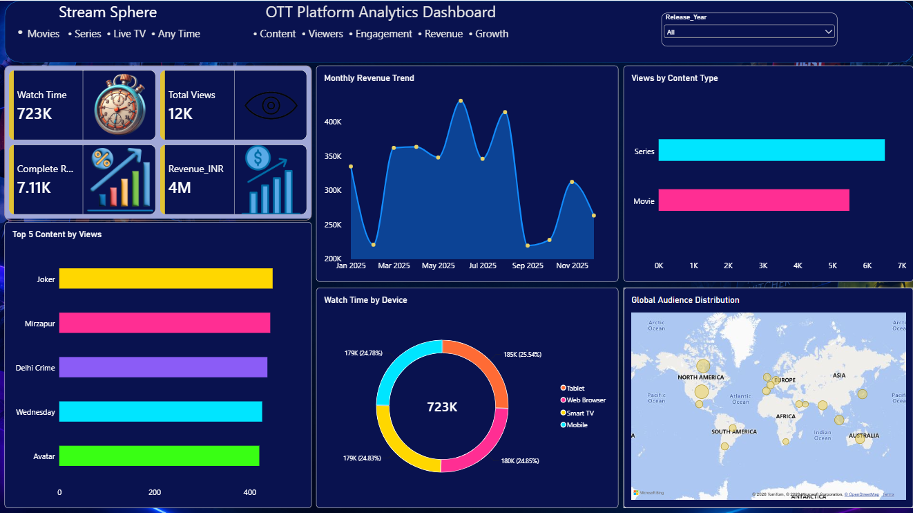

# 🎬 OTT Platform Analytics Dashboard — Stream Sphere

An interactive **OTT Platform Analytics Dashboard** built using Microsoft Power BI to analyze platform revenue, content performance, viewer engagement, device usage, and global audience distribution.

## 📊 Project Overview

Stream Sphere is a Power BI dashboard designed to transform OTT platform data into meaningful business insights. It provides a consolidated view of revenue trends, content consumption, watch time, and audience behavior through interactive visualizations.

## 🎯 Project Objectives

- Analyze monthly revenue trends.
- Compare views across movies and series.
- Identify the top-performing content by views.
- Analyze watch time across different devices.
- Explore global audience distribution.
- Present key performance indicators in an interactive dashboard.

## 🛠️ Tools & Technologies

- **Microsoft Power BI** — Dashboard development and data visualization
- **Power Query** — Data preparation and transformation, if used in the project
- **Data Modeling** — Organizing related datasets for analysis, if implemented

## 📁 Dataset Structure

The project uses datasets organized around the following areas:

| Dataset | Purpose |
|---|---|
| Content | Content titles, genres, types, languages, and release details |
| Monthly_Revenue | Monthly revenue, subscriptions, pricing, and discounts |
| Users | Audience demographics, countries, devices, and subscription details |
| Watch_Activity | Views, watch time, completion rates, and viewing activity |

*Dataset fields and availability may vary depending on the supplied raw files.*

## 📌 Key Performance Indicators

The dashboard includes KPI cards for:

- **Total Watch Time**
- **Total Views**
- **Content Completions**
- **Revenue (INR)**

The displayed KPI values depend on the loaded dataset and active report filters.

## 📈 Dashboard Visualizations

### 1. Monthly Revenue Trend
Tracks monthly revenue fluctuations to help evaluate revenue performance over time.

### 2. Views by Content Type
Compares audience views for movies and series.

### 3. Top 5 Content by Views
Highlights the five leading content titles by view count.

### 4. Watch Time by Device
Shows how viewing time is distributed across tablets, web browsers, smart TVs, and mobile devices.

### 5. Global Audience Distribution
Visualizes audience distribution geographically using country-level data.

### 6. Interactive KPI Cards
Summarizes key platform metrics in a single view.

## 🔍 Business Questions Answered

- How does revenue change month over month?
- Which content type receives more views?
- Which titles attract the most views?
- How is watch time distributed across devices?
- Where is the platform's audience located?
- What are the platform's key performance indicators?

## 💡 Potential Business Applications

The dashboard can help stakeholders:

- Monitor revenue performance.
- Identify popular content.
- Understand device preferences.
- Explore audience distribution.
- Support content planning and platform growth decisions.

## 📂 Repository Structure

```text
OTT-Platform-Analytics/
│
├── README.md
├── Dashboard.png
├── OTT_Platform_Analytics.pbix
└── Dataset/
    ├── Content.csv
    ├── Monthly_Revenue.csv
    ├── Users.csv
    └── Watch_Activity.csv
```

*Update the filenames to match your actual files. Include only files that are available and permitted to share.*

## 🚀 How to Use

1. Clone or download this repository.
2. Download and install Microsoft Power BI Desktop.
3. Open `OTT_Platform_Analytics.pbix`.
4. If prompted, update the dataset source paths.
5. Refresh the data and explore the dashboard using the available filters.

## 📷 Dashboard Preview


Then display it here:



## 👨‍💻 Author

**Rahul Raigar**

Aspiring Data Analyst | Business Intelligence | Data Visualization

Connect with me on [LinkedIn](https://www.linkedin.com/).

---

If you find this project useful, consider giving the repository a ⭐.
